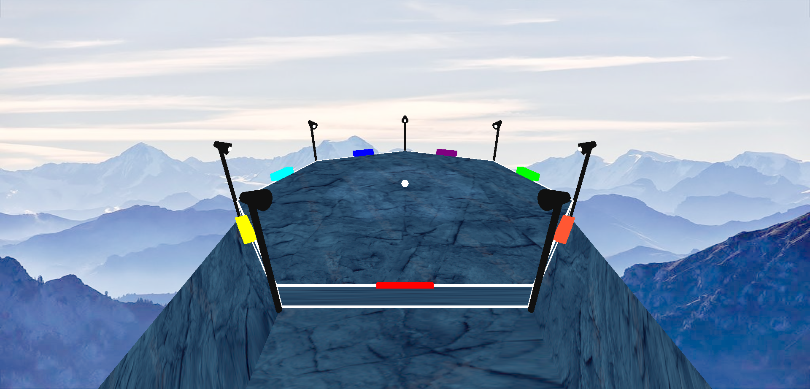
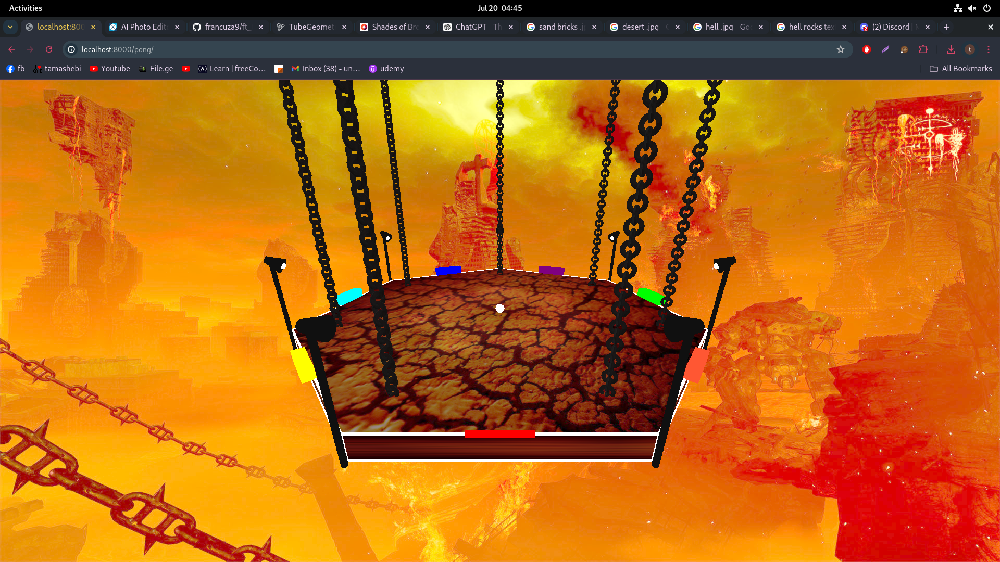
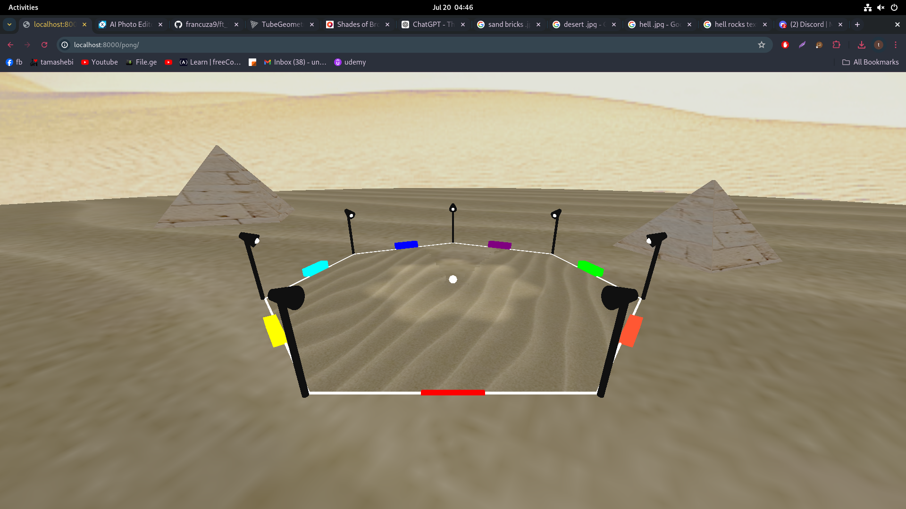
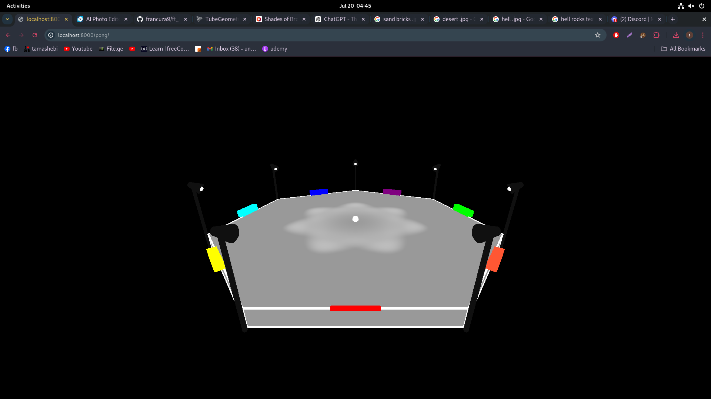
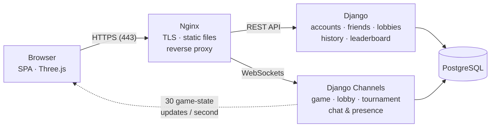

<div align="center">

# ft_transcendence

**A multiplayer 3D Pong website: up to 8 players per arena, online tournaments, an AI opponent, accounts, friends and live chat.**


<table>
<tr>
<td></td>
<td></td>
</tr>
<tr>
<td></td>
<td></td>
</tr>
</table>

<sub>The 8-player arena on its four maps: Mountain, Hell, Desert and Classic.</sub>

</div>

---

## What it is

The final project of the École 42 common core: a full web application built by a team of four, from the database to the 3D renderer. Players sign up (or log in with GitHub or their 42 account), find a lobby, and play Pong in the browser against friends, strangers or an AI, while the server keeps the game fair.

## Features

| | |
|---|---|
| **Game modes** | 1v1 on one keyboard · 1v1 online · up to 8 players online in one arena · tournaments with matchmaking · vs AI |
| **AI opponent** | Four levels: Novice, Moderate, Brutal and Insane, each with its own decision logic and reaction time |
| **3D game** | Rendered with Three.js, with four themed arenas |
| **Accounts** | Registration, login, guest mode, and OAuth with GitHub and the 42 intranet; avatars and profile editing |
| **Social** | Friends and friend requests, blocking, live online status, direct messages |
| **Stats** | Match history and a win-rate leaderboard |
| **Languages** | English, French, German, Spanish, Dutch, Arabic and Georgian |
| **Security** | HTTPS only, CSRF protection, hashed passwords |

## Architecture



| Part | Technology |
|---|---|
| Backend | Django REST endpoints for accounts, friends, lobbies, history and leaderboard |
| Real-time | Django Channels (ASGI) with WebSocket consumers for the game, lobbies, tournaments, chat and presence |
| Frontend | A plain JavaScript single-page app with client-side routing and Bootstrap; Three.js for the game |
| Web server | Nginx terminates TLS, serves static files and proxies HTTP and WebSocket traffic |
| Database | PostgreSQL |
| Deployment | Docker Compose: one container each for Nginx, Django and PostgreSQL |

**The server is authoritative.** Clients only send their inputs; the game loop runs on the server, moves the ball, detects hits and goals, and broadcasts the state to every player 30 times a second. Nobody can cheat by editing their browser.

## What it took

| Area | Details |
|---|---|
| **Real-time systems** | A server-side game loop and state broadcast over WebSockets to up to 8 players |
| **Game logic** | Ball physics and collisions for 2- and 8-player arenas, scoring, an AI with four behaviours |
| **Backend** | Django models, REST views, sessions, OAuth 2.0 flows with GitHub and 42 |
| **Frontend** | A single-page app without a JS framework, a 3D scene in Three.js, translations in 7 languages |
| **Infrastructure** | Containerising three services and wiring TLS, proxying and WebSockets through Nginx |
| **Teamwork** | Four people working on one codebase with Git |

## Project structure

```
dockers/
├── django/src/transcendence/
│   ├── pong/              models, REST views, WebSocket consumers, AI
│   └── transcendence/     settings, ASGI, routing
├── nginx/
│   ├── static/            the single-page app: js, css, html, 3D textures, translations
│   └── nginx.conf         TLS, static files, HTTP + WebSocket proxy
└── postgresql/            database image and init script
docker-compose.yml
```

## Run it

Requires Docker with Compose. Create a `.env` file at the root with the database, Django and OAuth settings used in `docker-compose.yml`, then:

```bash
git clone https://github.com/francuza9/ft_transcendence.git && cd ft_transcendence
make              # build and start the three containers
make down         # stop them
make annihilate   # remove containers, images and volumes
```

Then open <https://localhost>.

## Team

Built by four students at École 42 Angoulême: [George Tskitishvili](https://github.com/francuza9), mdev9, jwadie-a and Y-Wassef.

---

<div align="center"><sub>École 42 common core project · <a href="https://tskdev.org">tskdev.org</a></sub></div>
